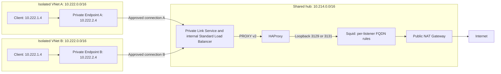

# Azure Private Link + Squid egress showback

**Same source IP, different policies.** In a synthetic Azure lab, two isolated VNets used the same client IP, `10.222.1.4`, to reach a shared proxy. Each VNet could reach its own allowed hostname and was denied the other.

## Architecture overview



There was no VNet peering or Azure Firewall. Only the shared hub had a public NAT Gateway. Direct HTTPS from either spoke was blocked.

## From VNet to Squid policy and logs

**The VNet ID is looked up, not transmitted.** Azure resource metadata ties an endpoint's subnet to its VNet and the approved provider-side connection to its `linkIdentifier`. Private Link sends that LinkID in PROXY v2 TLV `0xEE`, alongside the original client IP. HAProxy uses the LinkID to choose a Squid listener, then sends a new PROXY v2 header that preserves the source IP without forwarding the Azure TLV.

```mermaid
flowchart TB
    subgraph PATHA["Connection A"]
        A_META["VNet A from endpoint subnet ID"]
        A_PE["Private Endpoint A: approved PLS connection"]
        A_ID["PROXY v2: LINK-A and source 10.222.1.4"]
        A_PROXY["HAProxy selects Squid listener spoke_a:3129"]
        A_POLICY["Allow example.com; deny example.org"]
        A_LOG["Squid log: port=3129 client=10.222.1.4"]
        A_META --> A_PE --> A_ID --> A_PROXY --> A_POLICY --> A_LOG
    end
    subgraph PATHB["Connection B"]
        B_META["VNet B from endpoint subnet ID"]
        B_PE["Private Endpoint B: approved PLS connection"]
        B_ID["PROXY v2: LINK-B and source 10.222.1.4"]
        B_PROXY["HAProxy selects Squid listener spoke_b:3131"]
        B_POLICY["Allow example.org; deny example.com"]
        B_LOG["Squid log: port=3131 client=10.222.1.4"]
        B_META --> B_PE --> B_ID --> B_PROXY --> B_POLICY --> B_LOG
    end
```



`LINK-A` and `LINK-B` are aliases for distinct Azure-assigned IDs. Unmapped IDs have no backend. To attribute a decision, follow the logged listener port back through the HAProxy mapping to the approved Private Link connection, then to the endpoint and its VNet. The endpoint resource ID identifies the subscription. Squid itself logs the listener port and source IP, not the VNet ID, subscription ID, or LinkID.

## Observed results

| Origin | LinkID alias | Squid listener | Logged client IP | Allowed | Denied |
|---|---|---|---|---|---|
| VNet A | `LINK-A` | `spoke_a` / `3129` | `10.222.1.4` | `example.com` (200) | `example.org` (403) |
| VNet B | `LINK-B` | `spoke_b` / `3131` | `10.222.1.4` | `example.org` (200) | `example.com` (403) |

Both allowed CONNECT requests returned 200 and carried a certificate-verified HTTP 200 response from the origin. These are selected Squid fields, with `spoke` and `link` added by correlating the listener ports with the deployed mappings:

```text
spoke=A link=LINK-A port=3129 client=10.222.1.4 method=CONNECT result=TCP_TUNNEL/200 target=example.com:443
spoke=A link=LINK-A port=3129 client=10.222.1.4 method=CONNECT result=TCP_DENIED/403 target=example.org:443
spoke=B link=LINK-B port=3131 client=10.222.1.4 method=CONNECT result=TCP_TUNNEL/200 target=example.org:443
spoke=B link=LINK-B port=3131 client=10.222.1.4 method=CONNECT result=TCP_DENIED/403 target=example.com:443
```

The lab used one subscription. It demonstrated VNet-level attribution, not cross-subscription traffic. The policy filters the CONNECT destination hostname, not URL paths inside the TLS tunnel. An endpoint connection identifies neither a user nor a process.

References: [Azure Private Link service and PROXY v2](https://learn.microsoft.com/en-us/azure/private-link/private-link-service-overview#getting-connection-information-using-tcp-proxy-v2), [HAProxy PROXY protocol TLVs](https://www.haproxy.com/documentation/haproxy-configuration-tutorials/proxying-essentials/client-ip-preservation/enable-proxy-protocol/#receive-tlv-fields), and [Squid listener options](https://www.squid-cache.org/Versions/v6/cfgman/http_port.html).
